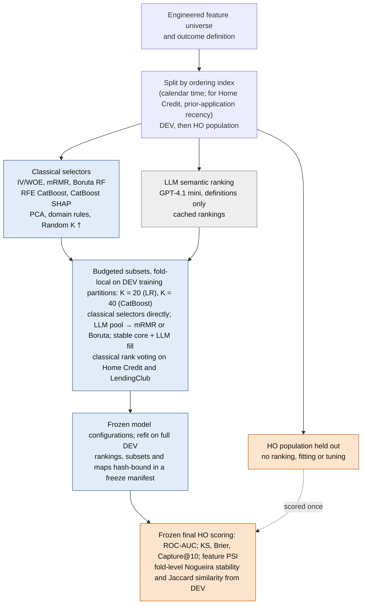

# Row-Independent Feature Pre-Screening with Language Models for High-Dimensional Credit Scoring

### A Frozen Evaluation on Temporal and Recency-Shift Holdouts

  

**Dilshod A'zamjonov**<sup>1,3,*</sup> and **Sejuti Rahman**<sup>2</sup>

<sup>1</sup> Department of Engineering, New Uzbekistan University, Tashkent, Uzbekistan ·
<sup>2</sup> Department of Computing, New Uzbekistan University, Tashkent, Uzbekistan ·
<sup>3</sup> Central Bank of the Republic of Uzbekistan, Tashkent, Uzbekistan ·
<sup>*</sup> corresponding author, d.azamjonov@newuu.uz

This repository holds the code, configuration files, cached LLM rankings, result files and headline subsets behind the manuscript above, submitted to *Big Data Research* ([Citation](#citation)). The result files are frozen at tag `v1.0-submission`. The sections below follow the manuscript; [Section 15](#15-known-deviations-between-the-checked-in-code-and-the-manuscript) lists where the checked-in code and artefacts differ from it.

> **Abstract (manuscript).** Supervised feature selection over engineered credit-scoring universes of hundreds to thousands of predictors is recomputed in every fold and refit, on up to millions of decisions. We ask whether a large language model (LLM) that reads only the variable book (names, descriptions and lineage; no data rows) can pre-screen such a universe before statistical selection. Its cost depends on the size of the book, not on the number of decisions, and its cached ranking is reused at every refit. Thirteen strategies are evaluated on Home Credit, LendingClub and Home Credit Model Stability 2024 (up to 1,959 features and 1,526,659 decisions) with logistic regression and CatBoost at budgets of 20 and 40 features, on holdouts later in time or shifted in applicant recency, each scored once by pipelines frozen beforehand. The best LLM-assisted and classical selectors (family leaders) are compared by paired differences in the area under the ROC curve (AUC). The LLM-assisted leader is higher in five of six cases whether leaders are chosen on held-out results (+0.012 to +0.051), on development folds (+0.014 to +0.052) or by a mixed rule, and loses less AUC from development to holdout. Home Credit logistic regression favours the classical leader under every rule (−0.010 to −0.027), and on LendingClub logistic regression the margin rests on a favourable cached LLM response. Semantic pre-screening is a usable, dataset-dependent first-pass filter, not a replacement for statistical selection, and needs stability and drift monitoring.

**Keywords:** Big data · High-dimensional data · Credit scoring · Feature selection · Large language models · Temporal validation · Selection stability

---

## Contents

1. [What this repository is](#1-what-this-repository-is)
2. [Key findings](#2-key-findings)
3. [Research questions and contributions](#3-research-questions-and-contributions)
4. [Pipeline](#4-pipeline)
5. [Datasets and the DEV/HO design](#5-datasets-and-the-devho-design)
6. [Feature-selection strategies](#6-feature-selection-strategies)
7. [LLM pre-screening protocol](#7-llm-pre-screening-protocol)
8. [Backbones, budgets and preprocessing](#8-backbones-budgets-and-preprocessing)
9. [Metrics and inference](#9-metrics-and-inference)
10. [Leakage and reproducibility controls](#10-leakage-and-reproducibility-controls)
11. [Results](#11-results)
12. [Result files](#12-result-files)
13. [Reproduction](#13-reproduction)
14. [Repository layout](#14-repository-layout)
15. [Known deviations between the checked-in code and the manuscript](#15-known-deviations-between-the-checked-in-code-and-the-manuscript)
16. [Protocol history and superseded material](#16-protocol-history-and-superseded-material)
17. [Limitations](#17-limitations)
18. [Citation](#citation)
19. [Licence, data terms and declarations](#licence-data-terms-and-declarations)

---

## 1. What this repository is

A research code base developed through several protocol versions on development data (manuscript Section 4.6 and Appendix E). Sections 4 to 10 describe the final protocol as the manuscript specifies it and name the code for each part. Three deliverables are frozen and tracked:

| | Where | What |
|---|---|---|
| Result files | `results/homecredit_metrics_output/`, `results/lendingclub_metrics_output/`, `results/stability_metrics_output/` | One CSV per manuscript table or robustness check, with the same 25 files and headers in each folder ([Section 12](#12-result-files)). Every manuscript value that has a local source is in one of them; the 107 that have none are left empty. |
| Headline subsets | `results/headline_subsets.csv` | The twelve subsets of Appendix D (supplementary Tables S1 to S6): two leaders × six cases, in selector order |
| Cached LLM rankings | `results/llm_rankings/` | The cached responses behind the LLM-assisted results on Home Credit (6 calls) and LendingClub (24 calls), the obfuscation arms, the lineage-only calls and the name lists of the ten repeated Stability 2024 calls; `index.csv` describes every call |

`uv run python scripts/verify_manuscript_tables.py --check` compares every CSV value with the value printed in the manuscript (transcribed in `scripts/manuscript_oracle.py`) and exits non-zero on any mismatch; `--render` prints the manuscript tables from the CSVs. At the freeze it compares 1,040 values: 917 match, 107 have no CSV source, 16 are flagged as known discrepancies and none mismatches.

Raw data (Kaggle), fitted models, fold checkpoints, cached training frames and generated reports are not tracked and are not needed to read the results ([Section 13](#13-reproduction)).

## 2. Key findings

From the manuscript's six paired comparisons (three datasets × two backbones) between the best LLM-assisted and the best classical selector of each case, the family leaders, with every holdout scored once by frozen pipelines:

- The LLM-assisted leader is higher in **five of six cases** whether leaders are chosen on held-out results (HO rule, +0.012 to +0.051), on development folds (DEV rule, +0.014 to +0.052) or by the mixed rule. **Home Credit logistic regression** favours the classical leader under every rule (−0.010 to −0.027).
- From DEV mean to HO AUC the classical leaders fall by 0.008 to 0.022 in five cases and hold level on Stability 2024 LR, whereas the LLM-assisted leaders move by −0.010 to +0.012. The LLM-assisted leader has the lower mean selected-feature PSI in five of six cases and the lower median in all six; all twelve means lie an order of magnitude below the conventional action threshold of 0.10.
- The best-discriminating selector is among the **least reproducible**: refitted classical selectors reach a Nogueira stability of at least 0.78, whereas the cached Pure LLM lists differ from fold to fold (Nogueira 0.41 to 0.63).
- On **LendingClub logistic regression** the headline response is favourable: with any of the other five cached responses the HO-rule margin would fall below the 0.010 materiality bar.
- The semantic stage reads no data rows and is computed at most once per partition. On Stability 2024 fold 1 the mRMR stage took 522 seconds over the unscreened 1,959-feature universe and 21 seconds over a 100-feature pool. The direct API cost of the 30 Home Credit and LendingClub ranking calls lies between USD 0.171 and USD 0.413.
- On Home Credit, replacing every feature name by a seeded identifier leaves the held-out AUC of Pure LLM within 0.005 of the named result, whereas removing the definitions costs about 0.03; descriptions generated from lineage serve as well in all three datasets.

## 3. Research questions and contributions

**RQ1.** Does an LLM pre-screened subset discriminate at least as well as a classically selected one on a held-out population scored once by a frozen pipeline, under a fixed budget?
**RQ2.** Are the selected subsets reproducible across development folds?

The manuscript makes four contributions:

1. A frozen held-out comparison of classical and LLM pre-screened selection on three credit portfolios of up to 1,959 engineered features and 1,526,659 decisions, under two backbones and three leader rules, reported as effect sizes with paired bootstrap intervals; one rule chooses the compared methods without held-out information.
2. A cost-structure argument: the semantic stage reads no data rows and is computed at most once per partition and reused at every refit, whereas every supervised selector is refitted in every fold and refit over all the rows of its partition. The evidence is a design-level analysis plus one matched runtime measurement, not a scaling study.
3. An explicit information contract for every selection stage, separating target-free from target-aware stages under freeze and leakage controls, with discrimination, fold-to-fold reproducibility and drift reported as distinct outcomes.
4. A pre-declared classical rank-voting family, fixed in a protocol file before any of its held-out results existed, as the one tested comparison.

## 4. Pipeline

As specified in the manuscript (Section 4.1, Figure 1); the pipeline runs in the same order for every dataset.



*Figure 1 of the manuscript, redrawn. Grey: target-free stages that consume metadata only. Blue: target-aware stages confined to DEV training partitions and refitted once on full DEV; PCA, domain rules and Random K (†) are themselves target-free. Orange: the held-out population, which the frozen final pipelines score once.*

1. **Assembly and outcome.** The engineered universe is assembled (529 predictors for Home Credit, 675 for LendingClub, 1,959 for Stability 2024) and the event definition is applied. On Stability 2024 a prediction-time availability review of 461 source variables approved 434 raw predictors.
2. **Split and folds.** Each dataset is split along its ordering index into a development (DEV) and a held-out (HO) population, and DEV into five expanding-window folds.
3. **Candidate set.** Every selector, classical and LLM-assisted, chooses from the same candidate set: the features with at most 90 % missing values on the training partition of the earliest fold (373, 675 and 1,068 features). The screen uses no outcomes, is computed once per dataset and is held fixed across the folds. The information-value interval 0.01 ≤ IV ≤ 0.50 serves the IV/WOE ranker and the screening stage of IV then Boruta; its upper bound removed nothing.
4. **Selection.** The thirteen strategies of [Table 1](#6-feature-selection-strategies) and the classical voting family of Appendix B each produce a subset of K original features; target-aware selectors are fitted per fold.
5. **Fitting and validation.** The fixed backbone configurations are fitted on the subset; fold validation yields development discrimination and the five fold subsets used for stability.
6. **Freeze and HO scoring.** Everything is refitted on full DEV, and rankings, subsets and settings are recorded in a hash-bound manifest. The frozen pipeline then scores HO once, and nothing is retuned afterwards.

The LLM ranking, domain rules, Random K, principal components and the missingness screen are target-free. Information value, mRMR, Boruta, recursive elimination, SHAP ranking, the stable-core construction and model fitting are target-aware and confined to DEV training partitions.

## 5. Datasets and the DEV/HO design

| | Home Credit | LendingClub v2 | Stability 2024 |
|---|---|---|---|
| Source | Home Credit Default Risk (Kaggle) | All Lending Club loan data (Kaggle) | Home Credit – Credit Risk Model Stability (Kaggle) |
| Unit and event | Loan application; payment difficulties (provider target) | 36- or 60-month loan resolved by the 2019-05-01 snapshot; charged off or defaulted | Credit decision; default (provider target) |
| Ordering index | `DAYS_DECISION` of the most recent previous application (recency) | Days from the issue month to 2018-12-01 (calendar time) | `date_decision` (calendar time) |
| DEV window, N, event rate | day −600 to −241; 99,092; 7.93 % | day −1795 to −1096 (issued 2014-01 to 2015-12); 598,649; 19.54 % | 2019-01-01 to 2020-02-25; 1,221,743; 3.24 % |
| HO window, N, event rate | day −240 to −1; 120,053; 8.90 % | day −1065 to −730 (issued 2016-01 to 2016-12); 293,105; 23.29 % | 2020-02-26 to 2020-10-05; 304,916; 2.74 % |
| Feature universe | 529 original features from the application record and auxiliary tables | 675 engineered features from roughly 93 distinct columns of the loan book | 1,959 engineered features from 434 approved raw predictors |
| Candidate set (all selectors) | 373 of 529 | 675 of 675 | 1,068 of 1,959 |

Source: `results/*_metrics_output/01_cohort.csv`, `results/*_metrics_output/02_candidate_set.csv`.

- **Home Credit** is a recency-based covariate-shift holdout, not a calendar split: DEV holds applicants whose most recent previous application is 241 to 600 days old and HO those with a more recent one, a riskier subgroup (8.90 % against 7.93 %). Features that are functions of the index are outside every candidate set. The two windows cover 219,145 of the 307,511 applications in the public release.
- **LendingClub v2** excludes every post-origination field and the platform's own pricing and grading fields (`int_rate`, `grade`, `sub_grade`, `installment`, `funded_amnt`), so its AUC levels are not comparable with studies that retain them. The highest missingness of any feature on the earliest training partition is 82 %, so the screen retains all 675. The population is resolved loans only.
- **Stability 2024** has its HO cutoff at 2020-02-26, fixed when the dataset was added to the study. The depth-0 tables `static_0` and `static_cb_0` and ten depth-1 table families are reduced to one row per case by outcome-independent aggregations, and every feature keeps its lineage (raw table, raw variable, depth, operation, type rule). The HO window overlaps the onset of the COVID-19 pandemic; the ordering of the two families is the same in all nine calendar months it touches.

Within DEV, five expanding-window folds are formed along the same index, with one index unit (a day; a decision date on Stability 2024) assigned to neither partition. Every component is fitted on the training partition, applied to the validation partition without refitting, and refitted once on full DEV.

Construction code: `src/credit_risk_fs/feature_engineering/homecredit/` (Home Credit), `src/credit_risk_fs/feature_engineering/lendingclub/` with `scripts/prepare_lendingclub_v2.py` (specification: `docs/lendingclub_v2_feature_engineering_spec.md`), and `src/credit_risk_fs/data/homecredit_model_stability_2024/` (Stability 2024; protocol lock `configs/protocols/homecredit_model_stability_2024_v1/third_dataset_protocol_lock.json`, which records the DEV and HO date ranges above and the fold boundaries).

## 6. Feature-selection strategies

Table 1 of the manuscript, with the registry key and module of each strategy in this repository. "Labels" states whether the stage that produces the final subset uses DEV outcomes; "Datasets" states where the strategy is evaluated on held-out data.

| Method | Family | Selection role | Labels | Datasets | Code |
|---|---|---|---|---|---|
| Full features | Reference | No selection; context only | – | All three | `full_features`, `src/credit_risk_fs/selectors/lightweight/registry.py` |
| Domain rules | Classical | Eligibility and policy filters written for the Home Credit variable book | no | All three (a) | `domain_rule_baseline`, `src/credit_risk_fs/selectors/domain_rule_baseline.py` |
| Random K | Classical | Baseline: uniformly random subset of size K, the floor for every selector | no | All three | `random_k`, `src/credit_risk_fs/selectors/lightweight/registry.py` |
| PCA | Classical | Leading components of the standardised candidates (components, not original features) | no | All three | `pca`, `src/credit_risk_fs/selectors/pca.py` |
| IV/WOE | Classical | Ranking by information value | yes | All three | `iv_woe`, `src/credit_risk_fs/selectors/lightweight/iv.py` |
| mRMR | Classical | Mutual-information relevance against mutual-information redundancy | yes | All three | `mrmr_mutual_information`, `src/credit_risk_fs/selectors/lightweight/mi_mrmr.py` |
| Boruta RF | Classical | All-relevant random-forest wrapper with shadow-feature comparison | yes | All three | `boruta_random_forest`, `src/credit_risk_fs/selectors/heavy/boruta_rf.py` |
| IV then Boruta | Classical | Hybrid: IV eligibility screen followed by Boruta confirmation | yes | All three | `iv_then_boruta`, `src/credit_risk_fs/selectors/combinations.py` |
| RFE CatBoost | Classical | Model wrapper: recursive elimination driven by CatBoost importance | yes | All three | `rfe_catboost`, `src/credit_risk_fs/selectors/heavy/rfe_catboost.py` |
| CatBoost SHAP | Classical | Embedded: ranking by aggregated absolute SHAP contribution | yes | All three | `catboost_shap`, `src/credit_risk_fs/selectors/heavy/catboost_shap.py` |
| Pure LLM | LLM-assisted | Top-K names of the cached semantic ranking of the fold | no | All three | `llm`, `src/credit_risk_fs/selectors/llm_screening.py` |
| LLM then mRMR | LLM-assisted | Hybrid: semantic pool of 60 (LR) or 100 (CatBoost), then mRMR | yes | All three | `llm_then_mrmr`, `src/credit_risk_fs/selectors/llm_then_stat.py` |
| LLM then Boruta | LLM-assisted | Hybrid: semantic pool, then Boruta confirmation | yes | All three | `llm_then_boruta`, `src/credit_risk_fs/selectors/llm_then_stat.py` |
| Stable core + LLM fill | LLM-assisted | Hybrid: bootstrap-stable RF/correlation core completed from the LLM ranking | yes | All three | `stable_core_llm_fill`, `src/credit_risk_fs/selectors/stable_core_llm_fill.py` |
| *Diversity controls (not strategies of the comparison)* | | | | | |
| Family-capped classical | Control | HO-rule classical leader re-run with at most ⌈K/F⌉ features per source family | yes | All three | `apply_family_cap`, `scripts/todo_fill/gate4/subsets.py` |
| Depth-0 classical | Control | HO-rule classical leader restricted to the depth-0 candidates | yes | Stability 2024 | `depth0_only`, `scripts/todo_fill/gate4/steps.py` |

(a) The domain-rules scorer was written around the Home Credit variable book; on LendingClub v2 and Stability 2024 it is applied unchanged and is a portfolio-specific baseline rather than a generic domain baseline. F is the number of source families in the dataset's universe, 6, 17 and 12; the family cap is 4 (K = 20) and 7 (K = 40) on Home Credit, 2 and 3 on LendingClub, and 2 and 4 on Stability 2024. The diversity controls enter no family, leader choice or count, and the pre-declared classical rank-voting family below is a supplementary comparison, not a strategy of the table.

**Method details** (manuscript Sections 4.3 and 4.5). Each selector ranks the candidates by its own criterion and keeps the top K original features. *IV/WOE* ranks by information value with ten quantile bins on the training partition, and the same statistic defines the pre-screen of *IV then Boruta*. *mRMR* estimates mutual information on the training partition; its pool is the whole candidate set when used alone and the shortlist when it follows a semantic stage. *Boruta RF* confirms the features whose random-forest importance (500 trees of depth 6) exceeds the best shuffled shadow importance at α = 0.05 with two-step correction, and keeps the top K confirmed features; when fewer than K are confirmed, the subset holds the confirmed features alone and is flagged as below budget. *RFE CatBoost* removes 20 % of the surviving features per step by the importance of an internal CatBoost ranker (500 iterations, depth 6, learning rate 0.05) until K remain. *CatBoost SHAP* keeps the K features with the largest aggregate absolute SHAP contribution over a 10,000-row training sample. *Domain rules* is a deterministic credit-domain scorer that reads no data and calls no model: 42 named-variable rules, family and string-pattern rules for bureau, instalment, credit-card and previous-application aggregates, 15 property-attribute rules and nine semantic-group fallbacks assign each feature a priority, adjusted for aggregation suffixes and leakage status. *LLM then mRMR* takes the top 60 (LR) or 100 (CatBoost) names of the ranking as the pool and applies mutual-information mRMR on the fold training partition; *LLM then Boruta* applies Boruta to the same pool and truncates to the budget. *Stable core + LLM fill* runs the RF/correlation filter on five bootstrap resamples of the fold training partition (80 % with replacement, seeds 42 to 46); the features selected in at least four of the five form the core, ordered by selection frequency and mean rank, and the LLM ranking fills the remaining budget in rank order, without padding from unranked features.

**mRMR and the RF/correlation filter.** Throughout, *mRMR* denotes the mutual-information implementation (`mrmr_mutual_information`). The random-forest/correlation rule used inside the stable-core construction and the classical voting family is the *RF/correlation filter*; early versions of the study named it legacy mRMR. In this repository it is `RandomForestRelevanceMRMRSelector` in `src/credit_risk_fs/selectors/mrmr.py` (registry key `mrmr`).

**Classical rank-voting family** (manuscript Appendix B; Home Credit and LendingClub). For each dataset and backbone, the normalised ranks of three target-aware selectors fitted on the fold training partition, the RF/correlation mRMR filter, Boruta and RFE, are averaged; the top P ∈ {100, 200, 300} features form the candidate pool (P = 200 primary), and the budgeted subset of K features is selected from that pool. The reference is the RF/correlation mRMR filter applied to the whole candidate set of 373 or 675 features under the same backbone. The twelve comparisons were fixed in a protocol file before any of their held-out results were computed, and Holm correction is applied within each case's family of three tests. Code: `configs/protocols/cross_dataset_rank_voting_v1.yaml`, `src/credit_risk_fs/experiments/rank_voting.py`, `src/credit_risk_fs/analysis/voting_inference/`.

## 7. LLM pre-screening protocol

As specified in the manuscript (Section 4.4, Appendix A):

- **Model:** GPT-4.1 mini, snapshot `gpt-4.1-mini-2025-04-14`, Chat Completions, temperature 0, JSON response format. It never receives rows, outcomes, validation statistics or HO information. Temperature 0 does not make the model deterministic; the cached response, not a fresh call, is the reproducible artefact.
- **Information contract:** one prompt template (Appendix A) serves all three datasets under a single definition-only contract. Every call used the `definitions_only` evidence mode, which admits feature names, definitions, source lineage, aggregation operations and observation windows but no numerical summary, so missingness, moments, quantiles, cardinalities and every target-conditioned statistic are withheld; the prompt also forbids remembered dataset-specific results.
- **Request and validation:** the prompt asks for exactly the requested number of distinct names in priority order and excludes only features whose supplied definition or lineage reveals the outcome, post-decision information or the evaluation split. Every name must appear verbatim among the candidate records, and the array must hold exactly the requested number of distinct names; a failing response is re-requested up to three times, and no fallback ranking is used.
- **Call structure:** on Home Credit and LendingClub the ranking is requested separately for each of the five fold training partitions and for full DEV, over the same candidate list in every call. Home Credit has six rankings of 100 names whose prefixes give the budgets of 20, 40, 60 and 100; LendingClub has a separate call per partition and budget, 24 cached rankings. On Stability 2024 one ranking of 100 names over the 1,068 eligible features, accepted at the first attempt, served every fold. On Home Credit and LendingClub, 72 logical screening requests were served by 30 provider calls (806,757 input and 56,495 output tokens); the token usage of the Stability 2024 call was not recorded.
- **Descriptions:** on Home Credit, the data dictionary distributed with the competition data; on LendingClub, definitions of the source columns written by the first author from the platform's column documentation, with every derived feature described by a template; on Stability 2024, definitions of the approved raw predictors written by the first author from the provider's documentation. The feature-engineering code appends the aggregation operation and window to every base definition.
- **Eligibility:** the contract governs the evidence the model may use, not which variables are eligible. Fields that fair-lending rules in many jurisdictions treat as protected (`CODE_GENDER` and `NAME_FAMILY_STATUS` on Home Credit, the person-table sex field on Stability 2024) and age fields were eligible for every selector, and no exclusion was added to the prompt.
- **Ablations:** name obfuscation on Home Credit (arm A: every name replaced by an identifier `F001` to `F529` from a seeded permutation, seed 20260914, with literal names removed from the descriptions; arm B: names kept, descriptions blanked); descriptions rebuilt from lineage alone in all three datasets; ten repeated full-DEV calls on Stability 2024.

The prompts sent by the code are reproduced verbatim in [`docs/llm_prompt_protocol.md`](docs/llm_prompt_protocol.md). Cached responses: `results/llm_rankings/` (`index.csv`, [`results/llm_rankings/README.md`](results/llm_rankings/README.md)). Fresh calls need `OPENAI_API_KEY` in `.env` (see `.env.example`), return different rankings and are not needed to read the results.

## 8. Backbones, budgets and preprocessing

| Backbone | Budget | Configuration (manuscript Section 5.3; identical across selectors, not tuned on the three datasets) |
|---|---|---|
| Logistic regression | K = 20 | scikit-learn `liblinear`, L2, C = 1, at most 1,000 iterations, balanced class weights, seed 42 |
| CatBoost | K = 40 | depth 10, learning rate 0.01, L2 leaf regularisation 95, at least 290 observations per leaf, `rsm` 0.90, random strength 0.125, depthwise growth, Bernoulli subsample 0.55, Logloss with AUC evaluation, balanced class weights, seed 42, four threads, a fixed 1,500 iterations without early stopping |

Configuration files: `configs/models/lr.yaml` (L2 and C = 1 are the scikit-learn defaults and are not written in the file) and `configs/models/catboost.yaml`. Models: `src/credit_risk_fs/models/logistic_regression.py`, `src/credit_risk_fs/models/catboost_model.py`. The CatBoost configuration was carried over unchanged from the authors' prior credit-scoring work at the Central Bank of the Republic of Uzbekistan on a separate, non-public portfolio; no hyperparameter of either backbone was tuned on any partition of the three datasets. The full-feature reference uses the same configuration and is a context model, not a tuned upper bound.

The budgets were set in DEV-only experiments and frozen before HO evaluation (manuscript Appendix C; `results/*_metrics_output/17_budget_sweep.csv`). The budget counts original variables and one-hot expansion follows selection, so input width differs from K (Table F.3; `n_model_columns` in `results/*_metrics_output/09_leader_subsets.csv`). Two selectors depart from this order: PCA keeps components, and the statistical stage of LLM then mRMR on LendingClub v2 budgets one-hot columns.

Preprocessing, fitted on the training partition and refitted on full DEV: numeric infinities set to missing, mean imputation, standardisation; categoricals receive an explicit missing token and are one-hot encoded; unseen levels are ignored; levels rarer than 10 observations (Home Credit, Stability 2024) or 50 (LendingClub) are dropped. CatBoost receives the same one-hot expansion, so one map serves both backbones; the native-categorical re-run is a robustness check. Code: `src/credit_risk_fs/preprocessing/encoding.py`; the LendingClub threshold is `cat_min_frequency: 50` in `configs/datasets/lendingclub_v2.yaml`.

## 9. Metrics and inference

- **Headline:** ROC-AUC on HO. **Secondary:** KS (maximum separation), Brier score (not a calibration claim: balanced class weights, no recalibration), log loss, Capture@10 and Lift@10. **Drift:** type-aware feature PSI with states learned on DEV and frozen (mean, median and maximum over a subset). **Reproducibility:** Nogueira stability over the candidate set (d = 373, 675 and 1,068; comparable within a dataset only) and mean pairwise Jaccard over the ten fold pairs.
- **Leader rules.** *HO rule:* each family's selector with the highest HO AUC (descriptive; the intervals are not adjusted for that choice). *DEV rule:* the highest mean validation AUC over the five DEV folds; the holdout plays no part in the choice. *Mixed rule:* the DEV-chosen LLM-assisted leader against the HO-chosen classical leader.
- **Inference:** the paired HO AUC difference, LLM-assisted minus classical, with a 95 % interval from 2,000 target-stratified paired bootstrap resamples (seed 20260721) on identical observations paired by identifier (`SK_ID_CURR` on Home Credit, a stable identifier derived from the processed row on LendingClub, the decision identifier on Stability 2024). A difference of at least **0.010 AUC** (two Gini points) is material, the *materiality bar*; smaller differences are reported but not counted. No p-value is attached to the headline comparisons; the two-sided paired DeLong test with Holm's step-down adjustment is used only for the pre-declared voting family.

Code: KS in `src/credit_risk_fs/evaluation/metrics.py`; feature PSI in `src/credit_risk_fs/evaluation/drift.py`; Nogueira stability and Jaccard in `src/credit_risk_fs/evaluation/stability.py`; paired DeLong, the stratified paired bootstrap (2,000 resamples, seed 20260721), Holm adjustment and lift in `src/credit_risk_fs/evaluation/paired_inference.py`; the voting family's inference in `src/credit_risk_fs/analysis/voting_inference/`.

## 10. Leakage and reproducibility controls

As stated in the manuscript (Sections 4.1 and 5.7):

- HO rows are excluded from every screening, selection, ranking and tuning step, and every target-aware component is fitted fold-locally inside DEV and refitted once on full DEV.
- Cached rankings, subsets, preprocessing maps, model settings and fitted models are frozen and hash-bound before each final HO scoring run; every held-out population was scored once, by the frozen final pipelines.
- The LLM ranking, domain rules, Random K, PCA and the missingness screen are target-free; IV, mRMR, Boruta, RFE, SHAP, the stable-core construction and model fitting are target-aware.
- Seeds: 42 (classifiers and selectors), 42 to 46 (stable-core resamples), 20260721 (inference bootstrap), 20260914 (obfuscation permutation).
- Environment of the reported runs: Python 3.13.5, scikit-learn 1.8.0, CatBoost 1.2.10 and Boruta 0.4.3 (`uv.lock` pins the three libraries; `.python-version` gives 3.13), on a laptop with an Intel Core i7-13620H processor, 16 logical (10 physical) cores and 39.6 GiB of RAM, CPU only, four estimator threads, one experiment and one fold at a time.

Policy and protocol notes: `docs/leakage_policy.md`, `docs/experiment_protocol.md`, `docs/llm_prompt_protocol.md`.

## 11. Results

All values in this section are those printed in the manuscript; every one with a local source is in the CSV named under each table.

### 11.1 Headline comparison, HO rule (manuscript Table 3)

| Case | LLM-assisted leader (AUC) | Classical leader (AUC) | Full | ΔAUC [95 % CI] | PSI LLM / classical |
|---|---|---|---|---|---|
| Home Credit, LR | Stable core + LLM fill (0.7489) | mRMR (0.7699) | 0.7715 | −0.021033 [−0.022211, −0.019780] | 0.0053 / 0.0085 |
| Home Credit, CatBoost | Pure LLM (0.7935) | RFE CatBoost (0.7814) | 0.7860 | +0.012024 [+0.009313, +0.014841] | 0.0045 / 0.0097 |
| LendingClub v2, LR | Pure LLM (0.7402) | IV then Boruta (0.7098) | 0.7109 | +0.030431 [+0.029359, +0.031514] | 0.0125 / 0.0129 |
| LendingClub v2, CatBoost | LLM then mRMR (0.7707) | IV then Boruta (0.7201) | 0.7230 | +0.050517 [+0.049712, +0.051315] | 0.0104 / 0.0125 |
| Stability 2024, LR | Pure LLM (0.8322) | RFE CatBoost (0.8181) | 0.7659 | +0.0141 [+0.012823, +0.015339] | 0.0174 / 0.0092 |
| Stability 2024, CatBoost | Pure LLM (0.8716) | CatBoost SHAP (0.8509) | 0.8198 | +0.0207 [+0.017219, +0.023151] | 0.0109 / 0.0189 |

Source: `05_leader_delta_auc.csv` (rule `HO`), `06_leader_feature_psi.csv` and `03_ho_auc.csv` in each `results/*_metrics_output/`. "Full" is the untuned full-feature reference (373, 675 and the unscreened 1,959 features).

### 11.2 DEV rule (manuscript Table 4)

| Case | LLM-assisted leader (DEV mean; HO) | Classical leader (DEV mean; HO) | ΔAUC [95 % CI] |
|---|---|---|---|
| Home Credit, LR | LLM then mRMR (0.7472; 0.7432) | IV then Boruta (0.7652; 0.7534) | −0.010179 [−0.012863, −0.007592] |
| Home Credit, CatBoost | Pure LLM (0.7917; 0.7935) | IV then Boruta (0.7770; 0.7688) | +0.024700 [+0.021656, +0.027770] |
| LendingClub v2, LR | Pure LLM (0.7436; 0.7402) | RFE CatBoost (0.7211; 0.6989) | +0.041353 [+0.040619, +0.042072] |
| LendingClub v2, CatBoost | LLM then mRMR (0.7811; 0.7707) | RFE CatBoost (0.7347; 0.7190) | +0.051702 [+0.050900, +0.052499] |
| Stability 2024, LR | Pure LLM (0.8302; 0.8322) | RFE CatBoost (0.8178; 0.8181) | +0.0141 [+0.012823, +0.015339] |
| Stability 2024, CatBoost | Pure LLM (0.8598; 0.8716) | RFE CatBoost (0.8635; 0.8425) | +0.0291 [+0.027974, +0.030174] |

The mixed rule gives the Table 3 pairs in five cases and LLM then mRMR against mRMR on Home Credit LR (−0.027, point estimate). Source: `04_dev_fold_auc.csv` and `05_leader_delta_auc.csv` (rules `DEV` and `mixed`).

### 11.3 Every selector (manuscript Table 5; HO ROC-AUC, bold = HO-rule family leader)

| Selector | Home Credit LR | Home Credit CatBoost | LendingClub v2 LR | LendingClub v2 CatBoost | Stability 2024 LR | Stability 2024 CatBoost |
|---|---:|---:|---:|---:|---:|---:|
| *Classical family* | | | | | | |
| Domain rules | 0.7230 | 0.7293 | 0.5525 | 0.6128 | 0.7371 | 0.7791 |
| Random K | 0.6278 | 0.6854 | 0.6038 | 0.6718 | 0.6818 | 0.7502 |
| PCA | 0.6838 | 0.7091 | 0.6624 | 0.6787 | 0.7019 | 0.7692 |
| IV/WOE | 0.7381 | 0.7686 | 0.6821 | 0.7027 | 0.7781 | 0.8187 |
| mRMR | **0.7699** | 0.7599 | 0.6859 | 0.7020 | 0.7769 | 0.8308 |
| Boruta RF | 0.7397 | 0.7542 | 0.6557 | 0.6857 | 0.7611 | 0.8095 |
| IV then Boruta | 0.7534 | 0.7688 | **0.7098** | **0.7201** | 0.7976 | 0.8387 |
| RFE CatBoost | 0.7465 | **0.7814** | 0.6989 | 0.7190 | **0.8181** | 0.8425 |
| CatBoost SHAP | 0.7501 | 0.7795 | 0.6965 | 0.7151 | 0.8092 | **0.8509** |
| *LLM-assisted family* | | | | | | |
| Pure LLM | 0.7436 | **0.7935** | **0.7402** | 0.7335 | **0.8322** | **0.8716** |
| LLM then mRMR | 0.7432 | 0.7758 | 0.7179 | **0.7707** | 0.8112 | 0.8519 |
| LLM then Boruta | 0.7337 | 0.7657 | 0.6793 | 0.7002 | 0.8098 | 0.8385 |
| Stable core + LLM fill | **0.7489** | 0.7809 | 0.7048 | 0.7277 | 0.8171 | 0.8489 |
| *LLM-assisted leader − classical leader* | −0.021 | +0.012 | +0.030 | +0.051 | +0.014 | +0.021 |

Source: `03_ho_auc.csv`.

### 11.4 Reproducibility and response sampling (manuscript Tables 9, 10 and F.4)

- Most reproducible refitted classical selector of each case (Nogueira / mean Jaccard): IV/WOE on Home Credit LR (0.8838 / 0.8053), Home Credit CatBoost (0.8403 / 0.7538), Stability 2024 LR (0.7860 / 0.6666) and Stability 2024 CatBoost (0.7793 / 0.6582); Boruta RF on LendingClub LR (0.9588 / 0.9273); mRMR on LendingClub CatBoost (0.9070 / 0.8462).
- Cached Pure LLM per-fold lists (Home Credit and LendingClub): Nogueira 0.41 to 0.63, Jaccard 0.31 to 0.48. The ten repeated Stability 2024 calls reach 0.8052 / 0.6908 (K = 20) and 0.7766 / 0.6506 (K = 40), level with the most reproducible classical selector of the case.
- Held-out AUC across the cached responses: spreads of 0.0038 to 0.0085, all inside the bar; on LendingClub LR the full-DEV response behind the headline lies 0.022 above its five fold responses, and the spread over all six is 0.0296.

Source: `07_selection_stability.csv`, `16_response_spread.csv`, `18_response_agreement.csv`.

### 11.5 Robustness of the five-of-six result (manuscript Table 6)

| Check | What it rules out | Result | Headline holds? | File |
|---|---|---|---|---|
| Leaders chosen on DEV folds | Pair chosen on HO results | LLM-assisted leader higher in 5 of 6, +0.014 to +0.052; classical leads Home Credit LR by 0.010 | Yes | `05_leader_delta_auc.csv` |
| DEV-chosen LLM-assisted against HO-best classical | A favourable pairing | HO-rule margins in five cases; Home Credit LR −0.027 | Yes | `05_leader_delta_auc.csv` |
| Native categorical handling (CatBoost) | One-hot artefact | AUC moves by at most 0.005; ordering unchanged in all three cases | Yes | `12_native_categorical.csv` |
| Per-family cap on the classical leader | Source concentration | Classical leader falls by 0.009 to 0.069; stays 0.021 to 0.083 below in 5 of 6; on Home Credit LR the families end level within the bar (−0.003) | Yes | `15_diversity_controls.csv` |
| Depth-0 restriction (Stability 2024) | Same-table pool | Classical leader 0.052 (LR) and 0.049 (CatBoost) below Pure LLM | Yes | `15_diversity_controls.csv` |
| Matured cohort (LendingClub) | Resolution filter | +0.018 (LR), +0.011 (CatBoost) | Yes | `11_subpopulation_ho_auc.csv` |
| Term split (LendingClub) | Term mix | 36 months +0.022 / +0.012; 60 months +0.014 / +0.010 | Yes | `11_subpopulation_ho_auc.csv` |
| Monthly breakdown (Stability 2024) | One favourable period | Pure LLM higher in all nine months under both backbones, above the bar in every month | Yes | `11_subpopulation_ho_auc.csv` |
| Name obfuscation (Home Credit) | Name recall | −0.0012 (LR), +0.0042 (CatBoost) | Yes | `19_obfuscation.csv` |
| Descriptions rebuilt from lineage | Hand-written phrasing | Held-out AUC moves by −0.0064 to +0.0074 | Yes | `13_lineage_only.csv` |
| Ten repeated LLM calls (Stability 2024) | A favourable response | Spread 0.0085 (LR) and 0.0050 (CatBoost); margin above the bar in all 20 refits | Yes | `16_response_spread.csv` |
| Five per-fold responses (Home Credit, LendingClub) | A favourable response | Spread at most 0.0075; the LendingClub LR headline response lies 0.022 above its fold range | Partly (LendingClub LR) | `16_response_spread.csv` |
| L1-penalised selector | Missing standard baseline | Below the classical leader in every case | Yes; changes no leader | `14_l1_selector.csv` |

### 11.6 Secondary metrics, drift, cost and rank voting

Best HO secondary metric per dataset (manuscript Table 11): Home Credit KS 0.4264, Brier 0.1234 and Capture@10 0.3630 (Lift@10 3.63), all Pure LLM with CatBoost; LendingClub v2 KS 0.3898 and Brier 0.1824 (LLM then mRMR, CatBoost) and Capture@10 0.2751 (Lift@10 2.75; Pure LLM, LR); Stability 2024 KS 0.5681, Brier 0.1538 and Capture@10 0.4417 (Lift@10 4.42), all Pure LLM with CatBoost. Mean selected-feature PSI runs from 0.0045 to 0.0189, and no feature of a headline subset exceeds 0.10. Peak process memory was 7.4 to 10.7 GB on Home Credit, 19.1 to 29.0 GB on LendingClub and 27.0 to 29.0 GB on Stability 2024. Source: `08_secondary_metrics.csv`, `06_leader_feature_psi.csv`, `09_leader_subsets.csv`, `21_llm_usage.csv`, `22_runtime_and_memory.csv`.

The pre-declared classical rank-voting family (manuscript Appendix B, Table B.1) raises HO AUC over a single classical filter in all twelve comparisons, by +0.0020 to +0.0129, with 95 % intervals that exclude zero and every difference Holm-significant within its family of three tests, at lower fold-to-fold reproducibility (mean fold Jaccard 0.40 to 0.49 against 0.62 to 0.72). Source: `results/homecredit_metrics_output/20_rank_voting.csv` and `results/lendingclub_metrics_output/20_rank_voting.csv` (the P = 200 rows).

## 12. Result files

The three `results/*_metrics_output/` folders share one numbering and one schema. [`results/README.md`](results/README.md) maps every manuscript table, figure and quoted number to a file and column, and states the provenance convention: `00_run_ids.csv` in each folder lists the source artefact and SHA-256 of every file, and those source paths are local to the machine on which the files were assembled.

| File | Manuscript |
|---|---|
| `01_cohort.csv`, `02_candidate_set.csv` | Table 2, Figure 2 |
| `03_ho_auc.csv`, `04_dev_fold_auc.csv`, `05_leader_delta_auc.csv`, `06_leader_feature_psi.csv` | Tables 3, 4 and 5, Figure 3 |
| `07_selection_stability.csv`, `16_response_spread.csv`, `18_response_agreement.csv` | Tables 9, 10 and F.4, Figure 4 |
| `08_secondary_metrics.csv` | Table 11 |
| `09_leader_subsets.csv`, `results/headline_subsets.csv` | Appendix D, Table F.3, Section 7.6 |
| `10_boruta_attainment.csv`, `11_subpopulation_ho_auc.csv`, `12_native_categorical.csv`, `13_lineage_only.csv`, `14_l1_selector.csv`, `15_diversity_controls.csv` | Appendix F, Tables 8, F.1 and F.2 |
| `17_budget_sweep.csv` | Appendix C, Table C.1, Figure C.1 |
| `19_obfuscation.csv`, `19b_obfuscation_ranks.csv`, `19c_obfuscation_fold_jaccard.csv` (Home Credit) | Table 7 and its note |
| `20_rank_voting.csv` (Home Credit, LendingClub) | Table B.1, Section 7.2 |
| `21_llm_usage.csv`, `22_runtime_and_memory.csv` | Section 6.7, Appendix F runtimes |

`uv run python scripts/verify_manuscript_tables.py --render` prints the manuscript tables from these files; `--check` compares them with the values transcribed in `scripts/manuscript_oracle.py`, and `tests/test_manuscript_tables.py` runs both checks.

## 13. Reproduction

### 13.1 Read the results (no data needed)

```bash
uv sync                                                      # Python 3.13; uv.lock pins scikit-learn 1.8.0, CatBoost 1.2.10, Boruta 0.4.3
uv run python scripts/verify_manuscript_tables.py --render   # manuscript tables from results/
uv run python scripts/verify_manuscript_tables.py --check    # exits non-zero on any mismatch
uv run python scripts/verify_manuscript_tables.py --schema   # structure of the result files
uv run pytest tests/test_manuscript_tables.py -q
```

The full test suite (`uv run pytest -q`) also contains contract tests that authenticate run artefacts kept outside the repository; those fail in a fresh clone.

### 13.2 Re-run the pipelines

Requires the three Kaggle datasets under `data/` (not tracked; obtain them from the providers and accept their terms), about 32 GB of RAM for LendingClub and Stability 2024, and days of CPU time.

```bash
uv run python scripts/check_setup.py --dataset homecredit         # config, data files, columns, descriptions, OPENAI_API_KEY if the LLM is enabled
uv run python scripts/prepare_homecredit.py                       # arranges the raw Home Credit files and metadata under data/homecredit/
uv run python scripts/prepare_lendingclub.py                      # resolved-loan LendingClub frame that LendingClub v2 starts from
uv run python scripts/prepare_lendingclub_v2.py                   # LendingClub v2 engineered frame and metadata
uv run python scripts/build_homecredit_model_stability_2024.py --help   # Stability 2024 universe with lineage
uv run python scripts/run_matrix.py --dataset homecredit --dry-run      # lists the configured matrix
uv run python scripts/run_matrix.py --dataset lendingclub_v2 --dry-run
uv run python scripts/run_prompt_16_third_dataset.py --help       # Stability 2024 DEV protocol; needs plan and authorisation files
uv run python scripts/run_prompt_16_final_oot.py --help           # Stability 2024 frozen HO scoring ("oot" is HO in legacy names)
```

The 529-feature Home Credit universe is assembled from the raw tables when the pipeline runs (`src/credit_risk_fs/pipelines/common.py` with `src/credit_risk_fs/feature_engineering/homecredit/`). A `--dry-run` of `run_matrix.py` lists the configured runs and writes their status files under the results directory without fitting anything. The final run's manifests, prediction files and fold outputs are not in this repository; they remain on the machine that ran the study. These commands therefore exercise the pipelines but do not, on their own, reproduce the reported numbers; [Section 15](#15-known-deviations-between-the-checked-in-code-and-the-manuscript) lists where the checked-in code differs from the manuscript.

The cached responses in `results/llm_rankings/` are renamed copies; `index.csv` gives, in `source`, the name under which each was cached. The pipeline code looks a ranking up by a hash of its request in its cache directory (`artifacts/llm_cache/` for the registry routes), so a re-run without API calls requires copying the files back under those names. Fresh calls (`OPENAI_API_KEY` in `.env`) return different rankings.

`scripts/fill_todo.py` and `scripts/fill_todo_gate4.py` (with `scripts/todo_fill/`) re-compute the robustness checks (sub-populations, response spread, obfuscation arms, lineage-only descriptions, diversity controls) from local run artefacts; their outputs are not tracked.

## 14. Repository layout

```
src/credit_risk_fs/        package
  data/                    dataset registry; Stability 2024 adapter and contract
  feature_engineering/     Home Credit and LendingClub v2 universes
  feature_metadata/        feature records and descriptions supplied to the LLM
  selectors/               classical, LLM and hybrid selectors (lightweight/: IV, MI-mRMR, L1, controls; heavy/: Boruta RF, RFE CatBoost, CatBoost SHAP)
  preprocessing/           cleaning, encoding, temporal split, leakage rules
  models/                  logistic regression and CatBoost backbones
  evaluation/              KS, feature PSI, Nogueira and Jaccard, paired DeLong and bootstrap
  experiments/             matrix runner, two-dataset baseline, selector combinations, Stability 2024 protocol (prompt_16_*), rank voting
  analysis/                voting-family inference
  pipelines/               dataset pipelines (reverse_transfer.py belongs to the superseded contrastive line)
  clip/                    superseded contrastive-representation line (Section 16)
credit_risk_fs/            import shim: adds src/credit_risk_fs to the package path when the repository root is on sys.path
scripts/                   preparation, execution, robustness-fill and verification entry points
configs/                   datasets, models, selectors, experiments, execution profiles, protocol locks
results/                   result files, headline subsets, cached LLM rankings (Section 12)
docs/                      protocol and policy notes, LLM prompt protocol, freeze report and evidence index
tests/                     unit, contract and manuscript-table tests
cleanup/tools/             repository validation and audit builders
```

`docs/repository_freeze.md` records how the result files were assembled and every gap found, and `docs/freeze_evidence_index.csv` lists the evidence examined for each manuscript element.

## 15. Known deviations between the checked-in code and the manuscript

The sections above follow the manuscript. This table lists every place where the checked-in code or the tracked artefacts differ from it, from the rows that bear on the headline comparisons (1 to 5) through those that bear on robustness, stability and appendix values (6 to 13) to those that change no reported number (14 to 16). The evidence behind each row is in `docs/repository_freeze.md`.

| # | Manuscript | Repository | Effect on reported numbers |
|---|---|---|---|
| 1 | Abstract, Sections 4.1 and 4.4, Table 1 ("Labels: no" for Pure LLM), Figure 1, Appendix A: the LLM reads only names, definitions and lineage (`definitions_only` in every call), over the same candidate list in every call. | The 30 cached Home Credit and LendingClub calls were made by `LLMSelector.fit` in `src/credit_risk_fs/selectors/llm_screening.py`. That path fits an IV/WOE prefilter on the fold's training labels (`min_iv` 0.01, `encode=True`; registry defaults in `src/credit_risk_fs/selectors/registry.py`) and builds each feature record from the WOE-encoded training frame (`missing_rate`, `non_null_count`, `dtype` and the mean, minimum, maximum, standard deviation, variance and 5th to 95th percentiles of the WOE values). It asks for "up to" 100 names, drops names outside the candidates and fills a short ranking with the highest-IV unranked candidates. The calls carried 374, 369, 365, 374, 372 and 391 candidate records on Home Credit and 155, 154, 155, 157, 160 and 161 on LendingClub. Stability 2024 and the obfuscation, lineage-only and repeated calls used the target-free path. | On Home Credit and LendingClub the LLM rankings were not target-free: their inputs included label-derived summaries and an IV screen. In the LendingClub CatBoost LLM then mRMR headline subset (+0.051), 22 of the 34 original variables come from the IV-ranked fill, because the budget-100 call returned 52 names. The Pure LLM subsets are not affected by the fill. |
| 2 | Appendix A: the template reproduced there was used, verbatim, for all three datasets. | No commit of this repository contains the Appendix A text. The target-free path sends the `stability_expert_v3` prompt and the Home Credit and LendingClub calls sent the prompt of `LLMSelector._build_prompt`; both are reproduced in `docs/llm_prompt_protocol.md`. | No reported ranking was produced with the Appendix A text as printed. |
| 3 | Section 5.6, Tables 3 and 4: each paired difference carries a 95 % interval from 2,000 target-stratified paired bootstrap resamples. | `scripts/recenter_pairwise_inference.py` rewrites the intervals and p-values of the pairwise table around "fixed, externally supplied AUC deltas": it shifts each paired-bootstrap interval by the difference between the delta held in the table and the delta computed from the paired predictions. The manuscript repository's pairwise table, the source of the Home Credit and LendingClub intervals, is in that script's output format. `scripts/recompute_pairwise_csv.py` notes that the supplied Home Credit IV then Boruta values are "closest to" the registered pool-100 runs; no registered run at pool 100, 200 or 300 gives the printed 0.7534 (LR) or 0.7688 (CatBoost). The paired predictions are not in this repository. | The Home Credit and LendingClub intervals of Tables 3 and 4 are not shown to be bootstrap intervals of the printed differences, and the Home Credit IV then Boruta values, the DEV-rule classical leaders of both Home Credit cases, match no registered run. |
| 4 | Sections 3.2 and 4.3: mutual information estimated by the Kraskov and Ross nearest-neighbour estimators. | `src/credit_risk_fs/selectors/lightweight/mi_mrmr.py` uses the plug-in estimator `sklearn.metrics.mutual_info_score` over ten quantile bins (objective `mid`); the repository has no nearest-neighbour estimator. | The stand-alone mRMR values for Home Credit CatBoost and both LendingClub cases are those of the discretised runs. The Home Credit LR mRMR value (0.7699, the HO-rule classical leader of that case) was scored from a prediction file of the RF/correlation filter, while its fold AUCs, KS, Brier and Appendix D subset come from the discretised run, whose held-out AUC is 0.7351. |
| 5 | Section 4.5, Table 1, Table E.1: LLM then mRMR applies mutual-information mRMR to the semantic pool. | The `llm_then_mrmr` route (`src/credit_risk_fs/selectors/registry.py`, `src/credit_risk_fs/selectors/llm_then_stat.py`) uses the RF/correlation filter; the repository has no mutual-information variant of the route. | As far as the checked-in code shows, the LLM then mRMR results, including the LendingClub CatBoost headline, used the RF/correlation stage. |
| 6 | Appendix B, Table E.1: three voters (RF/correlation mRMR, Boruta, RFE) averaged over the 373 or 675 candidates. | `configs/protocols/cross_dataset_rank_voting_v1.yaml`, `configs/experiments/cross_dataset_rank_voting_matrix_v1.yaml` and `src/credit_risk_fs/experiments/rank_voting.py` specify two voters (RF/correlation filter and Boruta, equal weights), CatBoost RFE as the downstream reducer to K, and universes of 529 and 675 features. Only the P = 200 rows of Table B.1 have a local artefact. | The protocol file in the repository is not the construction Appendix B describes. |
| 7 | Table 9 and Section 6.6.1: fold-to-fold reproducibility of the two LLM hybrids with a refitted statistical stage over the five development folds. | For the Home Credit rows of Stable core + LLM fill and LLM then Boruta the only local source is an archived report of a run whose held-out AUCs are not the manuscript's; its Nogueira values, filed at d = 529, give the printed values when rescaled to d = 373. | The stability and AUC values of these four rows come from different runs. |
| 8 | Sections 4.6 and 5.2: the Stability 2024 cutoff, 2020-02-26, was fixed when the dataset was added and not moved; the Stability 2024 rows of Tables 3 to 11 and Appendix F. | `results/stability_metrics_output/` was committed on 2026-10-08 from a re-run on the 2020-02-26 cohort whose outputs are not in this repository, and its recorded run ids match no file here. The Table 8 Stability LR interval and mechanical AUC equal a row that the manuscript repository computed on an earlier Stability 2024 cohort with a different cutoff, and the mean and median PSIs of three leaders equal that cohort's file. | The Stability 2024 values rest on the committed CSVs alone; the repository does not show that every one of them belongs to the 2020-02-26 cohort. |
| 9 | Tables 7, 8 and 10 and the native-categorical check of Appendix F. | `19_obfuscation.csv`, `13_lineage_only.csv`, `16_response_spread.csv` and `12_native_categorical.csv` copy the manuscript repository's result files. The local re-computations by `scripts/fill_todo.py` and `scripts/fill_todo_gate4.py` (outputs not tracked) differ from several of those values by constant offsets, or with the two obfuscation arms' logistic-regression fold AUCs exchanged. | These values are not reproduced by the checked-in fill scripts, and the run that produced them is not identified in the repository. |
| 10 | Appendix F: L1-penalised selector with balanced class weights, C = 0.05. | `src/credit_risk_fs/selectors/lightweight/lasso.py` defaults to `class_weight=None`, and the registered L1 runs (`configs/experiments/full_baseline_v1.yaml`) set no class weight; their held-out AUCs are not the manuscript's. `14_l1_selector.csv` holds the manuscript values, copied from the manuscript repository's result file. | The L1 values are not reproduced by any run in this repository. |
| 11 | Appendix C: pooled CatBoost change of −0.0006 at K = 50 and the coordinates of Figure C.1(a). | With the tracked Stability 2024 sweep (`17_budget_sweep.csv`) the pooled change is −0.0015 and the coordinates move by up to 0.0021; the printed values reproduce only with the earlier cohort's sweep, and a comment in the manuscript source states that the coordinates predate the Stability 2024 correction. `--check` flags these nine values. | The Appendix C pooled values do not match the tracked sweep. |
| 12 | Section 4.1 (step 3) and Section 4.3: the interval 0.01 ≤ IV ≤ 0.50 serves the IV/WOE ranker and the screen of IV then Boruta. | `src/credit_risk_fs/selectors/lightweight/iv.py` ranks by IV and keeps the top K without bounds; `src/credit_risk_fs/selectors/combinations.py` takes the top P features by IV (P = 100 on Home Credit, 300 on LendingClub, 200 on Stability 2024 in the registered runs). The interval appears only in the LLM prefilter of row 1. | Not determined from this checkout; the manuscript states that the upper bound removed nothing. |
| 13 | Section 4.3: Domain rules reads no data and assigns priorities by 42 named-variable rules, family and string-pattern rules, 15 property-attribute rules and nine semantic-group fallbacks. | Those rules are in `scripts/generate_homecredit_domain_rule_ranking.py`, whose ranking file no pipeline reads. The selector the pipelines run, `domain_rule_baseline` (`src/credit_risk_fs/selectors/domain_rule_baseline.py`), orders the features by semantic-group priority and then by training-partition missing rate and non-null count; the Stability 2024 protocol lock defers it ("no frozen mapping for the 2024 schema"). | Which implementation produced the Domain rules values is not determined from this checkout; Domain rules is never a family leader. |
| 14 | Data availability: the repository holds the cached LLM rankings. | The accepted Stability 2024 ranking (one call of 100 names over 1,068 candidates) is not included; its top 20 and top 40 are the Stability 2024 rows of `results/headline_subsets.csv`. The ten repeated Stability 2024 calls are included as name lists without their raw responses. The lineage-only calls in `results/llm_rankings/` are from a re-run and reproduce the Table 8 overlaps of the Home Credit and LendingClub LR cases only. | None; the Stability 2024 Pure LLM subsets can be checked against the subset files, not against the ranking. |
| 15 | Section 5.3: CatBoost `rsm` 0.90 and a fixed 1,500 iterations without early stopping. | `configs/models/catboost.yaml` spells `rsm` as `colsample_bylevel: 0.9` and carries `early_stopping_rounds: 150`, which is inactive because the model registry passes no evaluation set (`src/credit_risk_fs/models/registry.py`). | None. |
| 16 | Values throughout the manuscript. | 107 values have no local artefact and are empty in `results/`: the voting rows other than P = 200 and every voting interval and Holm p-value, the LendingClub hybrid stability values, the peak-memory ranges, Lift@10 for Home Credit and LendingClub, several runtimes and counts. Sixteen are flagged in `scripts/manuscript_oracle.py`: five Nogueira values that the artefacts give one unit away in the fourth decimal, the two EXT_SOURCE ranks of the Table 7 note, which the cached ranking orders the other way round, and the nine Appendix C values of row 11. | `--check` reports both groups; `docs/repository_freeze.md` lists them. |

## 16. Protocol history and superseded material

The manuscript (Section 4.6, Appendix E, Table E.1) describes the final protocol as the last of several versions developed and compared on the five development folds: a Home Credit comparison with 16 pipelines; a two-dataset comparison with five-fold Wilcoxon tests, abandoned as underpowered; matched-observation inference and voting variants; the three-dataset evaluation, which added Stability 2024 with the 2020-02-26 cutoff; the pre-declared cross-dataset classical voting family; the single held-out scoring run; and a reporting-only revision that withdrew the development-rule DeLong tests in favour of effect sizes with intervals and added the mixed rule. A contrastive-representation selector, with the Home Credit voting family built on it, was dropped as out of scope before the held-out run, and no held-out population was scored before the final pipelines were frozen.

Code and documents of superseded lines are kept for provenance and are not part of the reported study:

- the contrastive-representation (CLIP) line: `src/credit_risk_fs/clip/`, `src/credit_risk_fs/pipelines/reverse_transfer.py`, `configs/clip/`, `configs/clip_v2/`, `configs/corrected_homecredit_clip/`, `configs/corrected_lendingclub_to_homecredit/`, `docs/clip/`;
- LendingClub v1: `configs/datasets/lendingclub.yaml`, `configs/datasets/legacy/`, `configs/experiments/legacy/`, `docs/dataset_notes/lendingclub.md` (its preparation, `scripts/prepare_lendingclub.py`, produces the frame from which LendingClub v2 is built);
- the voting pilot and earlier protocol stages: `configs/experiments/cross_dataset_rank_voting_pilot_v1.yaml`, `configs/protocols/prompt_14_two_dataset_analysis_v1/`, the execution bridges under `configs/execution/`, and `docs/research_extension/`.

Legacy path names and older notes use the term `oot` for the held-out population; read it as HO. Index of superseded material: [`docs/superseded/INDEX.md`](docs/superseded/INDEX.md).

## 17. Limitations

From the manuscript (Section 7.7):

- The datasets are public releases with provider-defined targets whose horizons are not fully specified, so the chronological holdouts are not simulated deployments. The Home Credit design tests transfer to a recency-defined subgroup of applicants; LendingClub contains resolved loans only; Home Credit and Stability 2024 share institutional lineage, so the study does not contain three independent lenders. The Stability 2024 holdout is lower-risk than its development population (2.74 % against 3.24 %).
- The HO-rule leaders are identified from the held-out scoring, and the intervals account neither for that selection nor for the sampling of the language model. Each backbone has one fixed configuration, not tuned per selector.
- The language model's training data very likely include the public data dictionaries and write-ups of the Home Credit and LendingClub competitions; the obfuscation ablation tests name recall on Home Credit only. The rankings are cached artefacts of one model snapshot and one prompt.
- The study has no scaling curve over rows or features, only the one matched mRMR measurement, and the token usage of the Stability 2024 call was not recorded; variable books much larger than the 1,068 candidates of Stability 2024 are untested.
- The classical voting family covers Home Credit and LendingClub but not Stability 2024. The study does not evaluate profit, fairness, explanation stability or production deployment, and protected attributes were eligible for every selector.

## Citation

```bibtex
@unpublished{azamjonov2026rowindependent,
  author = {A'zamjonov, Dilshod and Rahman, Sejuti},
  title  = {Row-Independent Feature Pre-Screening with Language Models for High-Dimensional Credit Scoring: A Frozen Evaluation on Temporal and Recency-Shift Holdouts},
  note   = {Manuscript submitted to \emph{Big Data Research}},
  year   = {2026},
  url    = {https://github.com/dilshodazamjonov/Feature-Selection-Research}
}
```

DOI, volume and pages will be added on acceptance.

## Licence, data terms and declarations

- **Code and result files:** no licence file is included yet; until one is added, all rights are reserved.
- **Data:** the three datasets are publicly available on Kaggle, and their redistribution is governed by the terms of the respective competitions and dataset licences: [Home Credit Default Risk](https://www.kaggle.com/competitions/home-credit-default-risk/data), [All Lending Club loan data](https://www.kaggle.com/datasets/wordsforthewise/lending-club), [Home Credit – Credit Risk Model Stability](https://www.kaggle.com/competitions/home-credit-credit-risk-model-stability/data). They are not tracked here.
- **Funding and interests:** the research did not receive any specific grant from funding agencies in the public, commercial or not-for-profit sectors; the authors declare no known competing financial interests or personal relationships.
- **Disclaimer:** the views expressed are those of the authors and do not necessarily reflect those of the Central Bank of the Republic of Uzbekistan. The study uses public datasets only; no data of the Central Bank or of any supervised institution were used.
- **Generative AI:** the manuscript declares that the authors used Claude (Anthropic) only to generate the TikZ and pgfplots code of its five figures and to assist with its final revision, and that the result files behind the figures were produced by the authors' experiments without generative AI; GPT-4.1 mini is a component of the methods under study. In this repository, Claude Code (Anthropic) assisted in developing parts of the code and its documentation, including this README, and in assembling `results/` from the authors' existing result files.
